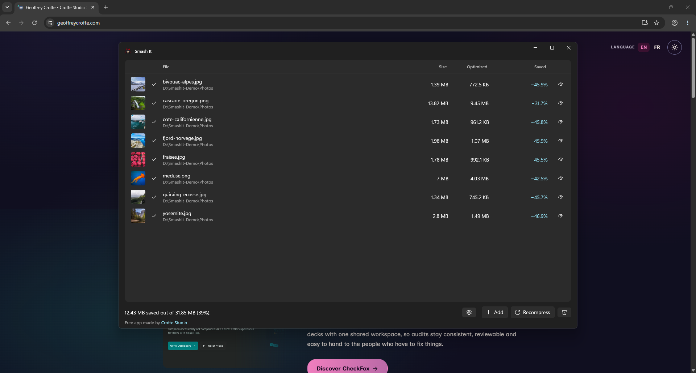
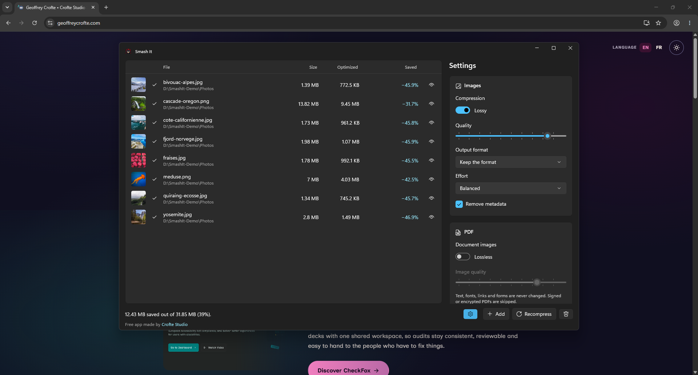

<p align="center">
  
</p>

# Smash It

A native Windows app to make images, videos and PDFs smaller — in the spirit of ImageOptim on macOS.

Drop files or folders on the window: Smash It tries every engine that can handle them, keeps the smallest
result, and only keeps it when it actually got smaller. By default the app is lossless and keeps your originals:
the result is saved next to each file as `name-compressed.ext`, or in a `compressed` folder if you prefer.

> Status: early development (v0.1). Images, PDFs and videos work today; the "Planned" column below lists what's coming.

## Download

Windows 10 (1809) or Windows 11, 64-bit. Nothing else to install: the .NET runtime and every compression tool
ship with the app.

- **[Installer](https://github.com/geoffreycrofte/smash-it/releases/latest/download/SmashIt-Setup-x64.exe)**:
  installs for your account only (no admin rights), adds "Compress with Smash It" to the Explorer right-click
  menu and can add the `smashit` command to the PATH.
- **[Portable zip](https://github.com/geoffreycrofte/smash-it/releases/latest/download/SmashIt-win-x64.zip)**:
  unzip anywhere and run `SmashIt.exe`. The command line is `cmd\smashit.cmd`.

The builds are not code-signed yet, so Windows SmartScreen may warn on first launch: click **More info**, then
**Run anyway**. Each release lists the SHA-256 of its files in `SHA256SUMS.txt`.

## Screenshots



| Settings, one section per kind of file | Before / after, with a draggable split |
|---|---|
|  |  |

<details>
<summary>Splash screen</summary>


</details>

<sub>Demo photos from [Lorem Picsum](https://picsum.photos) (Unsplash License). Splash screen shown over the default Windows 11 wallpaper.</sub>

## Features

| | Today | Planned |
|---|---|---|
| **Images** | JPEG, PNG, TIFF, BMP, JPEG XR, HEIC via the Windows Imaging Component; lossless JPEG (jpegtran) and PNG (oxipng) optimization; lossy PNG (pngquant); WebP (cwebp) and AVIF (avifenc) encoding | gifsicle, svgo |
| **Videos** | MP4 (H.264 or HEVC + AAC) through Media Foundation, GPU encoder when available; MOV/MKV/AVI become MP4 | ffmpeg for fine tuning (CRF, AV1, VP9) |
| **PDF** | Images recompressed in place (qpdf + jpegtran), object streams, Flate level 9; text, fonts, links, forms and bookmarks untouched | Image downsampling (DPI cap) |
| **Modes** | Lossless / lossy, quality 1–100, effort (fast / balanced / maximum) | Per-engine algorithm settings, presets |
| **Conversion** | HEIC/PNG/WebP/AVIF/… → JPEG, PNG, WebP, AVIF, HEIC, TIFF, JPEG XR, BMP | |
| **Metadata** | Strip EXIF/XMP/IPTC/comments or keep them (JPEG, PNG, WebP, AVIF outputs) | Other formats |
| **Originals** | Kept by default, with the result saved as `name-compressed.ext` or in a `compressed` folder; or replaced, the original going to the Recycle Bin | |
| **Preview** | Before/after comparison for every compressed image, with a draggable split | Zoom to 100 % |
| **Integration** | Drag & drop, Explorer right-click menu, `smashit` command line; settings remembered between launches | Custom script engines |
| **Languages** | English and French: French when Windows is in French, English otherwise, or chosen in Settings | |

### Lossy PNG

In lossy mode, pngquant reduces a PNG to a palette of up to 256 colors with dithering, often 60–80 % smaller
for screenshots, illustrations and UI graphics; oxipng then polishes the result. The quality setting is pngquant's
target, and an image that can't stay within 30 points of it (a photo with fine gradients, say) is left to the
lossless engines rather than visibly damaged. The color profile is kept: the pixels are quantized in the image's
own color space. Animated PNGs are skipped.

### PDF

Smash It never rebuilds a PDF. qpdf exports its streams, jpegtran optimizes every JPEG image losslessly, and qpdf
writes the new image data back under the same object numbers. In lossy mode, qpdf first re-encodes images as JPEG
at the chosen quality, keeping each one only when it gets smaller. The result must pass `qpdf --check` and keep the
same number of pages, or the original is left alone. Signed PDFs (any change would invalidate the signature) and
encrypted PDFs are skipped.

### Videos

Videos are re-encoded with the encoder built into Windows, so no extra tool is needed and the GPU does the work when
it can. Pick H.264 (plays everywhere) or HEVC (about 40 % smaller, needs a HEVC-capable player). The bitrate follows
the quality setting, the resolution and the frame rate, and never exceeds the source bitrate. Portrait phone videos
come out upright. Windows can only write MP4, so MOV/MKV/AVI files become `.mp4`, and only when that makes them
smaller. Videos need the lossy mode.

### Before/after preview

Every compressed image gets a compare button (or double-click its row). Both versions are stacked in one view; drag
the handle, click anywhere, or use ← → (Shift for finer steps) to move the split. The app keeps a temporary copy of
each original so the preview still works after the original went to the Recycle Bin.

### Explorer right-click menu

Right-click images, PDFs, videos or folders and pick **Compress with Smash It**: the files open in the Smash It
window and are compressed with the settings you last used there (the app remembers them between launches). Select
40 files and they all land in the same window. The installer adds the entry (an option you can untick); with the
portable zip, or to remove it, use **Settings → Windows Explorer**. On Windows 11 the entry is under
**Show more options**: the new top-level menu only accepts packaged, code-signed apps.

### Metadata and originals

- **Strip metadata** (default) removes camera info, dates, GPS, XMP, IPTC and comments. The color profile and the
  orientation are always kept, since dropping them would change how the picture looks.
- **Keep originals** (on by default) leaves your files untouched and saves the results either next to them as
  `photo-compressed.jpg` (or `photo-compressed.webp` for a conversion), or in a `compressed` folder next to them,
  under their own name (`compressed\photo.jpg`). When you drop several files or right-click a selection, Smash It
  asks which one you want, preset to your last choice; tick "Don't ask again" to stop the question (Settings brings
  it back). A `compressed` folder inside a folder you drop is skipped, so results aren't compressed twice.
  Turn **Keep originals** off and the compressed file replaces the original, which goes to the Recycle Bin.

Reading HEIC, WebP and AVIF relies on the free *HEIF*, *HEVC*, *WebP* and *AV1* image extensions from the Microsoft Store.

## Project layout

```
src/
  SmashIt.Core/    Compression engine: format detection, pipeline, compressors (no UI)
  SmashIt.App/     WinUI 3 desktop app (Windows App SDK, unpackaged, self-contained)
  SmashIt.Cli/     `smashit` command-line tool
tests/
  SmashIt.Core.Tests/
```

Every engine implements `ICompressor`. The `CompressionPipeline` asks each one whether it can handle a
job (input format, output format, lossless or lossy), runs the candidates and keeps the smallest output.
Adding a new engine (a bundled tool or your own script) means adding one class.

## Build

Requirements: Windows 10 1809+ / Windows 11, [.NET 10 SDK](https://dotnet.microsoft.com/download),
and [7-Zip](https://www.7-zip.org/) to unpack jpegtran (`winget install 7zip.7zip`).

`dev` at the repository root wraps the usual commands (`dev.cmd`, so it works from PowerShell and cmd alike,
whatever the execution policy):

| Command | Does |
|---|---|
| `.\dev tools` | Downloads the bundled tools (pinned versions, SHA-256 verified) into `tools\bin`: run it once first |
| `.\dev run [files…]` | Runs the app; files or folders given are compressed right away |
| `.\dev cli [options…]` | Runs the command line, e.g. `.\dev cli -q 75 C:\Photos` |
| `.\dev build` | Builds the solution |
| `.\dev test` | Runs the tests |
| `.\dev release` | Builds the installer and the portable zip into `artifacts\` (`-SkipInstaller` for the zip only) |
| `.\dev setup` | Builds the installer and starts it |
| `.\dev clean` | Deletes the build folders (`bin`, `obj`, `artifacts`); `tools\bin` stays |
| `.\dev` | Lists these commands |

The same with plain commands:

```powershell
powershell -ExecutionPolicy Bypass -File tools\fetch-tools.ps1
dotnet build SmashIt.slnx
dotnet test --solution SmashIt.slnx
dotnet run --project src/SmashIt.App
dotnet run --project src/SmashIt.Cli -- -q 75 "C:\Photos"
```

To try the Explorer right-click menu with a development build, turn it on in **Settings → Windows Explorer**,
and off again afterwards: it points to the build you turned it on from.

### Release

```powershell
# Installer + portable zip + SHA256SUMS.txt in artifacts\ (needs Inno Setup 6: winget install JRSoftware.InnoSetup)
.\dev release
```

The app and the command line are published into one folder and share a single self-contained runtime; the CLI
is `SmashIt.Cli.exe`, and `cmd\smashit.cmd` keeps the `smashit` command. To ship a version, bump `<Version>` in
`Directory.Build.props`, then push a tag (`git tag v0.2.0 && git push origin v0.2.0`): the *Release* workflow tests,
builds and attaches both files to a draft GitHub release, ready to review and publish.

## Command line

```
smashit [options] <files or folders…>

  --lossless           Lossless only (default)
  --lossy              Allow quality loss
  -q, --quality <n>    Quality 1–100 (implies --lossy)
  -t, --to <format>    Convert to jpg, png, webp, avif, heic, tif, jxr, bmp
  -e, --effort <n>     fast, balanced (default) or max
  --codec <codec>      Video: h264 (default) or hevc; needs --lossy or -q
  --keep               Keep the original, write "name-compressed.ext" next to it
  --folder             Keep the original, write the result into a "compressed" folder next to it
  --no-recycle         Delete the original instead of using the Recycle Bin
  --keep-metadata      Keep EXIF, XMP, IPTC and comments
  --strip-metadata     Remove them (default; color profile and orientation are kept)
```

## License

[GPL-3.0-or-later](LICENSE). Bundled third-party tools keep their own licenses: see [THIRD-PARTY-NOTICES.md](THIRD-PARTY-NOTICES.md).
