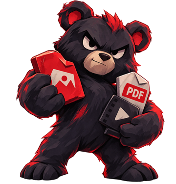
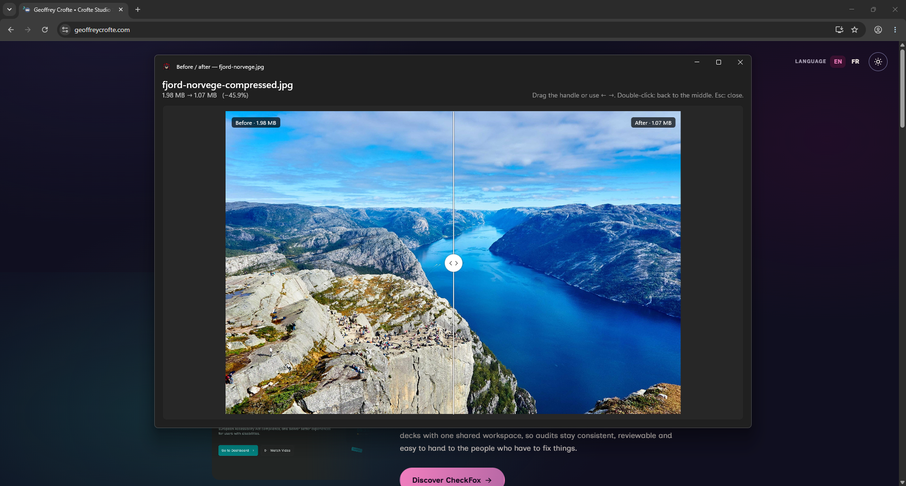
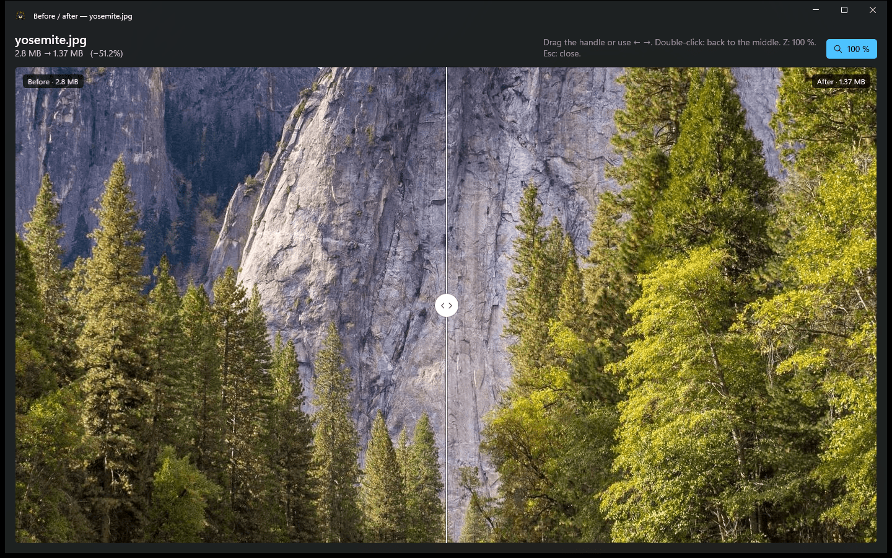
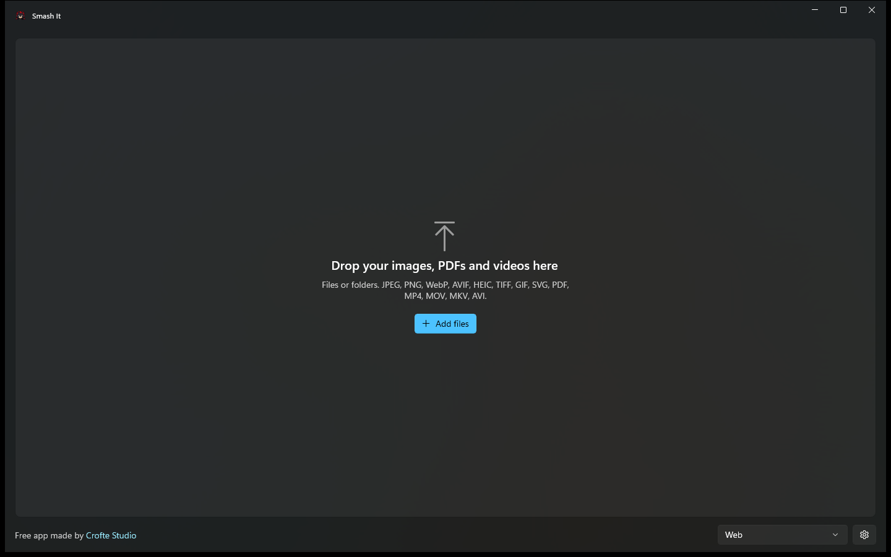
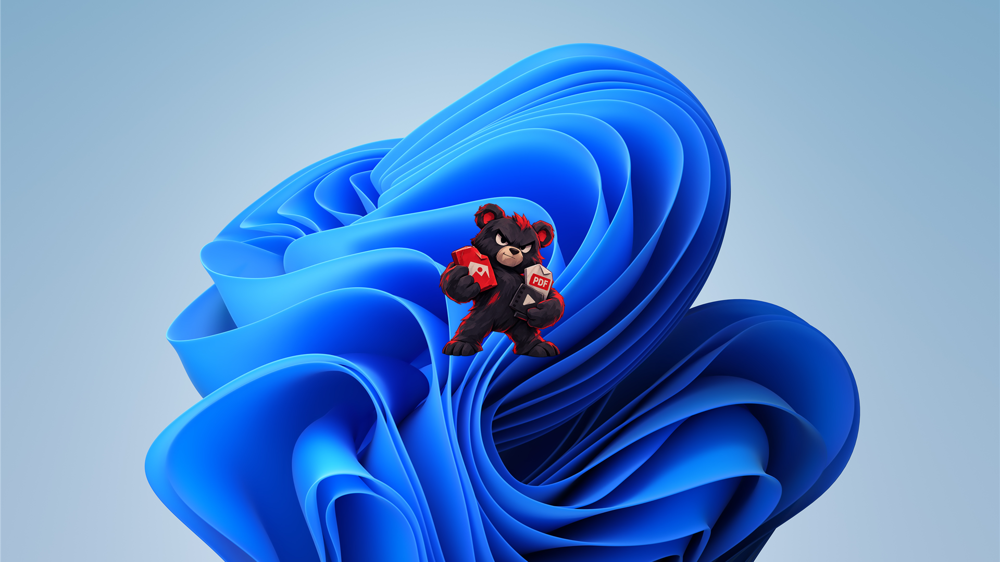

<p align="center">
  
</p>

# Smash It

A native Windows app to make images, videos and PDFs smaller — in the spirit of ImageOptim on macOS.

Drop files or folders on the window: Smash It tries every engine that can handle them, keeps the smallest
result, and only keeps it when it actually got smaller. By default the app is lossless and keeps your originals:
the result is saved next to each file as `name-compressed.ext`, or in a `compressed` folder if you prefer.

> Status: early development (v0.4). Images, PDFs and videos work today; the "Planned" column below lists what's coming.

What changed in each version: [CHANGELOG.md](CHANGELOG.md) ([en français](CHANGELOG.fr.md)). Using a keyboard or a screen reader:
[ACCESSIBILITY.md](ACCESSIBILITY.md). How releases are built and signed: [CODE_SIGNING.md](CODE_SIGNING.md).

## Download

Windows 10 (1809) or Windows 11, 64-bit. Nothing else to install: the .NET runtime and every compression tool
ship with the app.

- **[Installer](https://github.com/geoffreycrofte/smash-it/releases/latest/download/SmashIt-Setup-x64.exe)**:
  installs for your account only (no admin rights), adds "Compress with Smash It" to the Explorer right-click
  menu and can add the `smashit` command to the PATH.
- **[Portable zip](https://github.com/geoffreycrofte/smash-it/releases/latest/download/SmashIt-win-x64.zip)**:
  unzip anywhere and run `SmashIt.exe`. The command line is `cmd\smashit.cmd`.

The builds are not code-signed yet, so Windows SmartScreen may warn on first launch: click **More info**, then
**Run anyway**. Each release lists the SHA-256 of its files in `SHA256SUMS.txt`.

### Updates

At startup, Smash It asks GitHub for the list of releases (nothing else is sent) and shows a banner when a newer
version is out, with its release notes. With the installer, **Update** downloads the new installer, checks it
against the release's `SHA256SUMS.txt`, installs it silently and starts the app again, settings kept. The portable
build links to the download instead. After an update, a banner offers what's new. The check can be turned off,
or run on demand, in Settings → About. Pre-releases are only offered to people already running one.

## Screenshots


| Before / after, with a draggable split | The same at 100 %, pixel for pixel |
|---|---|
|  |  |

| Presets and settings, one section per kind of file | Ready for your files |
|---|---|
|  |  |

<details>
<summary>Splash screen</summary>



</details>

<sub>Demo photos from [Lorem Picsum](https://picsum.photos) (Unsplash License), saved as high-quality JPEGs as a camera would. Splash screen shown over the default Windows 11 wallpaper.</sub>

## Features

| | Today | Planned |
|---|---|---|
| **Images** | JPEG, PNG, TIFF, BMP, JPEG XR, HEIC via the Windows Imaging Component; lossless JPEG (jpegtran) and PNG (oxipng) optimization; lossy PNG (pngquant); GIF, animated or not (gifsicle); SVG (oxvg); WebP (cwebp) and AVIF (avifenc) encoding; lossy, optional maximum size (long side 3840, 2560, 1920 or 1280 px) | |
| **Videos** | MP4 (H.264 or HEVC + AAC) through Media Foundation, GPU encoder when available; MOV/MKV/AVI become MP4; optional 1080p or 720p cap | ffmpeg for fine tuning (CRF, AV1, VP9) |
| **PDF** | Images recompressed in place (qpdf + jpegtran) and, in lossy mode, scaled down to 150 or 300 dpi; object streams, Flate level 9; text, fonts, links, forms and bookmarks untouched | |
| **Modes** | Lossless / lossy, quality 1–100, effort (fast / balanced / maximum) | Per-engine algorithm settings |
| **Conversion** | HEIC/PNG/WebP/AVIF/… → JPEG, PNG, WebP, AVIF, HEIC, TIFF, JPEG XR, BMP | |
| **Metadata** | Strip EXIF/XMP/IPTC/comments or keep them: JPEG, PNG, WebP and AVIF results, from JPEG, PNG, WebP, HEIC and AVIF sources | HEIC results |
| **Originals** | Kept by default, with the result saved as `name-compressed.ext` or in a `compressed` folder; or replaced, the original going to the Recycle Bin | |
| **Preview** | Before/after comparison for every compressed image, with a draggable split, fitted or at 100 % | |
| **Presets** | Best quality (lossless, the default), Web (images 2560 px, videos 1080p), Email (lightest: 1920 px, 720p) and Archive (lossless, metadata kept), in the bottom bar and in Settings; "Custom" as soon as a setting is changed | |
| **Integration** | Drag & drop (or **Add files** in the empty window), Explorer right-click menu, `smashit` command line; settings remembered between launches | Custom script engines |
| **Languages** | English and French: French when Windows is in French, English otherwise, or chosen in Settings | |

### Image size

In lossy mode, **Maximum size** scales larger images down so their long side is 3840, 2560, 1920 or 1280 pixels,
never up. A 5000 px photo typically loses half its weight at 2560 px and three quarters at 1920 px, and stays
sharp on any screen. The
image is resized once, while it is decoded (Fant filter), then encoded by the engine you chose: JPEG, PNG through
pngquant, WebP, AVIF, animated GIF (every frame). The Web preset uses 2560 px, Email 1920 px; on the command line,
`--max-size 2560`. Lossless mode and SVG never change the size.

### Lossy PNG

In lossy mode, pngquant reduces a PNG to a palette of up to 256 colors with dithering, often 60–80 % smaller
for screenshots, illustrations and UI graphics; oxipng then polishes the result. The quality setting is pngquant's
target, and an image that can't stay within 30 points of it (a photo with fine gradients, say) is left to the
lossless engines rather than visibly damaged. The color profile is kept: the pixels are quantized in the image's
own color space. Animated PNGs are skipped.

### GIF

gifsicle optimizes GIFs, animated ones included: every frame, delay and loop setting is kept. Lossless, it stores
only what changes from one frame to the next and recompresses it. Lossy, it adds noise you can't see to make the
file compress much better: the lower the quality setting, the stronger (quality 85 is gifsicle's `--lossy=30`).
Comments and extensions are removed with the other metadata, unless you keep metadata.

### SVG

oxvg, a Rust port of SVGO, cleans what design tools leave in an SVG (editor data, hidden and empty elements,
default values, comments and metadata unless you keep metadata), rounds coordinates to 3 decimals and writes
shapes and paths more compactly. The image looks the same. A few things are kept on purpose: IDs (a stylesheet,
a script or another file may point to them), the `viewBox` (so the image still scales) and the title (read by
screen readers). As a safety net, the result is only used when it is a valid SVG with the same width, height and
`viewBox` as the original, and still has something to draw. SVG fonts (an old icon font format) are left as they
are: oxvg would remove their glyphs. oxvg publishes no Windows x64 build, so the *Build tools* workflow compiles it from its
tagged source (`git tag tools-oxvg-<version>`).

### PDF

Smash It never rebuilds a PDF. qpdf exports its streams, jpegtran optimizes every JPEG image losslessly, and qpdf
writes the new image data back under the same object numbers. In lossy mode, qpdf first re-encodes images as JPEG
at the chosen quality, keeping each one only when it gets smaller. The result must pass `qpdf --check` and keep the
same number of pages, or the original is left alone. Signed PDFs (any change would invalidate the signature) and
encrypted PDFs are skipped.

In lossy mode, images much finer than their size on the page are also scaled down, to 150 dpi by default (plenty
for a screen) or 300 dpi (print), set under **Maximum image resolution**. A scan at 600 dpi typically shrinks by
80 to 95 %. Smash It reads the page contents to know at what size each image is actually drawn, forms included,
and only touches an image that is more than 1.5 times finer than the target (Ghostscript's rule). Only plain
grayscale or RGB JPEG images are resampled; CMYK, masked or indexed images, and images not drawn on a page, stay
as they are. On the command line: `--pdf-dpi 300`, or `--pdf-dpi 0` to keep every image's resolution.

### Videos

Videos are re-encoded with the encoder built into Windows, so no extra tool is needed and the GPU does the work when
it can. Pick H.264 (plays everywhere) or HEVC (about 40 % smaller, needs a HEVC-capable player). The bitrate follows
the quality setting, the resolution and the frame rate, and never exceeds the source bitrate. **Maximum resolution**
brings larger videos down to 1080p or 720p (the short side of the picture, so portrait videos are treated the same),
never up: a 4K phone video at 1080p is typically 3 to 4 times lighter. The Web preset uses 1080p, Email 720p; on
the command line, `--video-max 1080`. Portrait phone videos
come out upright. Windows can only write MP4, so MOV/MKV/AVI files become `.mp4`, and only when that makes them
smaller. Videos need the lossy mode.

### Before/after preview

Every compressed image gets a compare button (or double-click its row). Both versions are stacked in one view; drag
the handle, click anywhere, or use ← → (Shift for finer steps) to move the split. **100 %** (or Z) shows the images
pixel for pixel, whatever the Windows display scaling, centered on the split: scroll with the wheel (Shift+wheel
sideways) or the scrollbars, and press it again to fit the window. The app keeps a temporary copy of
each original so the preview still works after the original went to the Recycle Bin.

### Explorer right-click menu

Right-click images, PDFs, videos or folders and pick **Compress with Smash It**: the files open in the Smash It
window and are compressed with the settings you last used there (the app remembers them between launches). Select
40 files and they all land in the same window. The installer adds the entry (an option you can untick); with the
portable zip, or to remove it, use **Settings → Windows Explorer**. On Windows 11 the entry is under
**Show more options**: the new top-level menu only accepts packaged, code-signed apps.

### Metadata and originals

- **Strip metadata** (default) removes camera info, dates, GPS, XMP, IPTC and comments. The color profile and the
  orientation are always kept, since dropping them would change how the picture looks.
- Untick it and EXIF and XMP follow the picture, including from an iPhone HEIC, an AVIF or a WebP to a JPEG, PNG,
  WebP or AVIF. Smash It reads them from the WebP chunks and the HEIF items itself, and adds them to WebP results
  (the Windows build of cwebp only copies the color profile). HEIC results can't carry them yet.
- **Keep originals** (on by default) leaves your files untouched and saves the results either next to them as
  `photo-compressed.jpg` (or `photo-compressed.webp` for a conversion), or in a `compressed` folder next to them,
  under their own name (`compressed\photo.jpg`). When you drop several files or right-click a selection, Smash It
  asks which one you want, preset to your last choice; tick "Don't ask again" to stop the question (Settings brings
  it back). With the folder, you can also have the files that are already optimal copied into it as they are, so
  it holds the whole set, ready to send or upload. A `compressed` folder inside a folder you drop is skipped, so results aren't compressed twice.
  Turn **Keep originals** off and the compressed file replaces the original, which goes to the Recycle Bin.

Reading HEIC, WebP and AVIF relies on the free *HEIF*, *HEVC*, *WebP* and *AV1* image extensions from the Microsoft Store.

## Project layout

```
src/
  SmashIt.Core/    Compression engine: format detection, pipeline, compressors (no UI)
  SmashIt.App/     WinUI 3 desktop app (Windows App SDK, unpackaged, self-contained)
  SmashIt.Cli/     `smashit` command-line tool
tests/
  SmashIt.Core.Tests/
```

Every engine implements `ICompressor`. The `CompressionPipeline` asks each one whether it can handle a
job (input format, output format, lossless or lossy), runs the candidates and keeps the smallest output.
Adding a new engine (a bundled tool or your own script) means adding one class.

## Build

Requirements: Windows 10 1809+ / Windows 11, [.NET 10 SDK](https://dotnet.microsoft.com/download),
and [7-Zip](https://www.7-zip.org/) to unpack jpegtran (`winget install 7zip.7zip`).

`dev` at the repository root wraps the usual commands (`dev.cmd`, so it works from PowerShell and cmd alike,
whatever the execution policy):

| Command | Does |
|---|---|
| `.\dev tools` | Downloads the bundled tools (pinned versions, SHA-256 verified) into `tools\bin`: run it once first |
| `.\dev run [files…]` | Runs the app; files or folders given are compressed right away |
| `.\dev cli [options…]` | Runs the command line, e.g. `.\dev cli -q 75 C:\Photos` |
| `.\dev build` | Builds the solution |
| `.\dev test` | Runs the tests |
| `.\dev release` | Builds the installer and the portable zip into `artifacts\` (`-SkipInstaller` for the zip only) |
| `.\dev setup` | Builds the installer and starts it |
| `.\dev clean` | Deletes the build folders (`bin`, `obj`, `artifacts`); `tools\bin` stays |
| `.\dev` | Lists these commands |

The same with plain commands:

```powershell
powershell -ExecutionPolicy Bypass -File tools\fetch-tools.ps1
dotnet build SmashIt.slnx
dotnet test --solution SmashIt.slnx
dotnet run --project src/SmashIt.App
dotnet run --project src/SmashIt.Cli -- -q 75 "C:\Photos"
```

To try the Explorer right-click menu with a development build, turn it on in **Settings → Windows Explorer**,
and off again afterwards: it points to the build you turned it on from.

### Release

```powershell
# Installer + portable zip + SHA256SUMS.txt in artifacts\ (needs Inno Setup 6: winget install JRSoftware.InnoSetup)
.\dev release
```

The app and the command line are published into one folder and share a single self-contained runtime; the CLI
is `SmashIt.Cli.exe`, and `cmd\smashit.cmd` keeps the `smashit` command.

To ship a version:

1. In `CHANGELOG.md`, rename "## Next version" to the version and date (`## v0.3.0 · January 15, 2027`), and
   add the same section, translated, to `CHANGELOG.fr.md`.
2. Set the same number in `<Version>` in `Directory.Build.props`, and commit all three on `main`.
3. Push a tag (`git tag v0.3.0 && git push origin v0.3.0`), or create the release on GitHub with a new tag.

The *Release* workflow tests and builds, then attaches the installer, the zip and `SHA256SUMS.txt`. A tag pushed
from git gets a draft release, ready to review and publish; a release created on GitHub gets the files and its
text replaced with the changelog section.

What's new lives in [`CHANGELOG.md`](CHANGELOG.md), written for users: one `## vX.Y.Z` section per version,
newest first. Work in progress goes under a heading that isn't a version ("## Next version"); rename it to
the version before tagging. The workflow then uses that section as the release text, and the app shows every
section above the version a person has, read from `CHANGELOG.md` as tagged with the new version (so unreleased
work on `main` never shows). A version without a section falls back to the release text. Headings, lists,
**bold**, `code` and links are rendered. The update banner reaches people as soon as the release is published
(drafts are never seen).

When the app is in French, each version's notes come from [`CHANGELOG.fr.md`](CHANGELOG.fr.md) instead, with the
same `## vX.Y.Z` titles; a version not translated yet shows in English. Other languages will follow the same
pattern (`CHANGELOG.<code>.md`).

## Command line

```
smashit [options] <files or folders…>

  --lossless           Lossless only (default)
  --lossy              Allow quality loss
  -q, --quality <n>    Quality 1–100 (implies --lossy)
  -t, --to <format>    Convert to jpg, png, webp, avif, heic, tif, jxr, bmp
  -e, --effort <n>     fast, balanced (default) or max
  --codec <codec>      Video: h264 (default) or hevc; needs --lossy or -q
  --keep               Keep the original, write "name-compressed.ext" next to it
  --folder             Keep the original, write the result into a "compressed" folder next to it
  --copy-all           Like --folder, and also copy the files that are already optimal
  --no-recycle         Delete the original instead of using the Recycle Bin
  --keep-metadata      Keep EXIF, XMP, IPTC and comments
  --strip-metadata     Remove them (default; color profile and orientation are kept)
```

## License

[GPL-3.0-or-later](LICENSE). Bundled third-party tools keep their own licenses: see [THIRD-PARTY-NOTICES.md](THIRD-PARTY-NOTICES.md).
